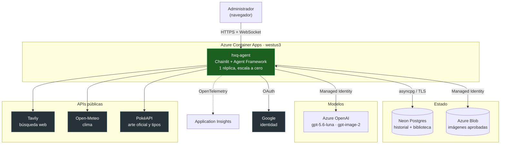
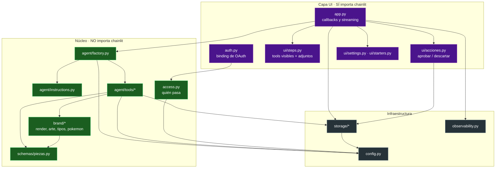
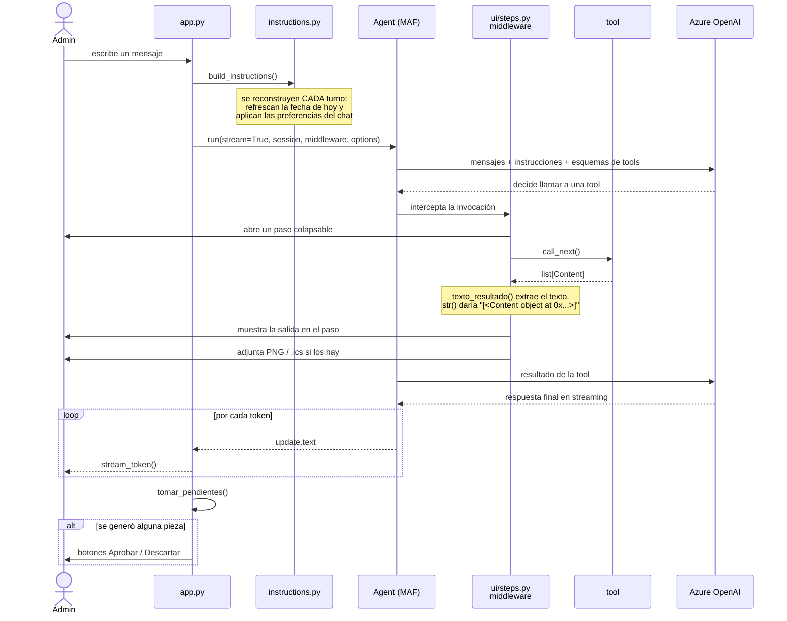
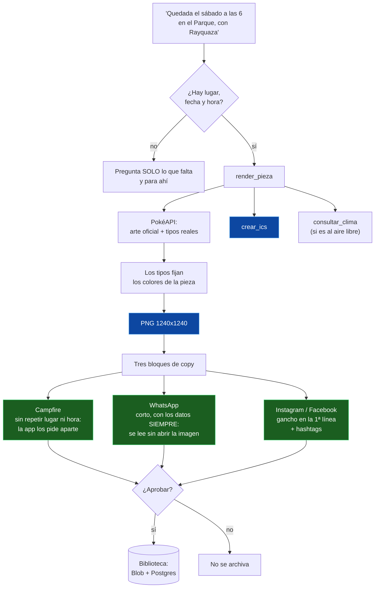
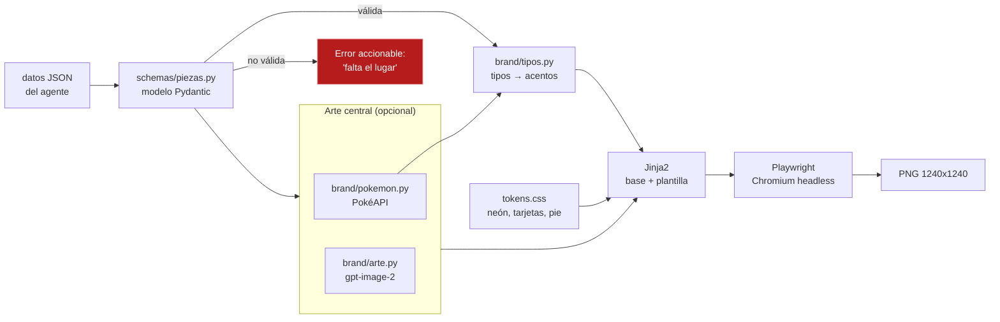
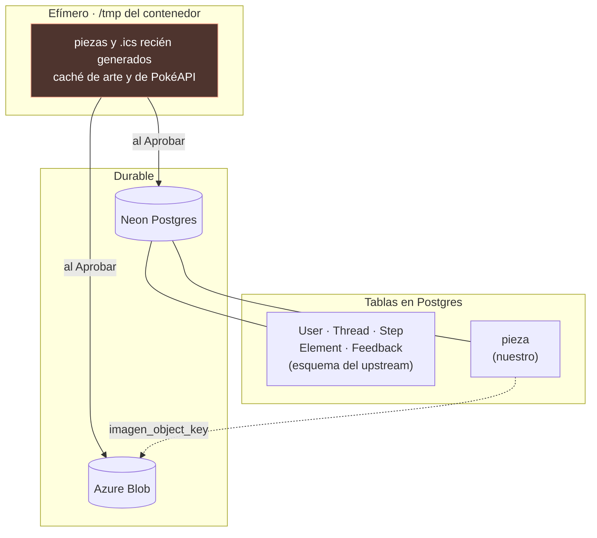
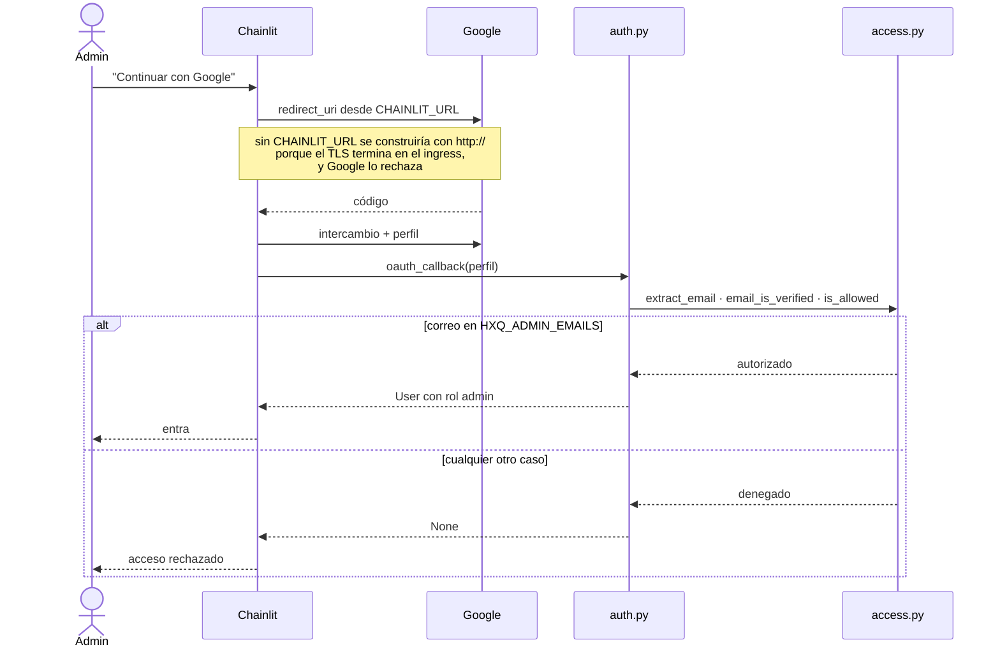
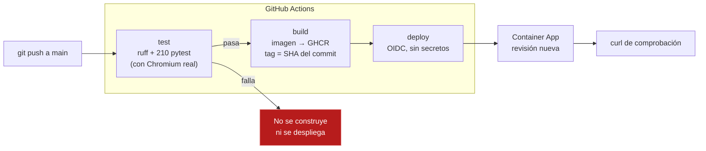

# Arquitectura de HuixquiGo Agent

Cómo está montada la aplicación y cómo viajan los mensajes entre sus piezas.
Refleja el estado del código a 27 de septiembre de 2026 (fases 0 a 5 completadas).

Para el *qué* y el *por qué* del producto, ver [`PLAN.md`](PLAN.md).
Para las trampas concretas de cada librería, [`API-VERIFICADA.md`](API-VERIFICADA.md).

---

## 1. Panorama general

El agente vive en un solo contenedor en Azure Container Apps. Todo lo que hay alrededor
son servicios gestionados o APIs públicas.

**Sin claves de larga vida hacia Azure.** El acceso a Azure OpenAI y a Blob Storage va
con la identidad administrada del contenedor. Las únicas credenciales que existen son las
de Google OAuth, Tavily y Neon, y viven como secretos de la Container App.

---

## 2. La frontera que gobierna el diseño

Hay una sola regla estructural, y de ella cuelga casi todo lo demás:

> **Nada bajo `agent/`, `brand/` o `schemas/` importa `chainlit`.**

Chainlit es *community-maintained* desde mayo de 2025. Aislarlo detrás de una capa fina
significa que cambiar de interfaz —a FastAPI + React, o al DevUI de Agent Framework— es
trabajo de días y no de semanas. Y como efecto secundario, el núcleo se prueba sin
levantar la app.

`access.py` existe separado de `auth.py` por esa regla y por una razón práctica:
`@cl.oauth_callback` revienta al importarse si no hay proveedor configurado, así que la
lógica de quién entra no se podría probar sin montar OAuth.

`storage/` es la excepción parcial: el *data layer* es una interfaz de Chainlit, así que
`storage/db.py` la importa. `storage/biblioteca.py` y `storage/blob.py` no dependen de
ella para su lógica.

---

## 3. Un turno de conversación

Lo que pasa desde que el admin escribe hasta que ve la respuesta.

Dos decisiones de orden que importan:

- **Las instrucciones se reconstruyen por turno**, no una vez por sesión. Así la fecha de
  hoy se recalcula (relevante si una pestaña queda abierta pasada la medianoche) y los
  controles del chat aplican de inmediato.
- **Los botones de aprobación salen al cerrar el turno**, no cuando termina la tool. El
  copy por canal lo escribe el agente *después* de dibujar la pieza; un botón junto a la
  imagen archivaría la pieza sin el texto que la acompaña.

---

## 4. El paquete de quedada

El flujo insignia: de una frase suelta a todo lo necesario para anunciar una quedada.

Los tres bloques son deliberadamente distintos, no el mismo texto recortado. Cada canal
tiene restricciones propias y el agente las conoce por instrucción.

---

## 5. Motor de piezas gráficas

Por qué una plantilla HTML y no un modelo de imagen: **fecha, hora y lugar tienen que
salir exactos**. Un modelo de imagen los escribe mal lo bastante a menudo como para que
no sirva, y una pieza con la hora equivocada llega a toda la comunidad.

**El arte oficial gana sobre el generado.** Además de que Azure rechaza generar propiedad
intelectual (`moderation_blocked`), un Pokémon dibujado por IA se nota y no es el que la
gente espera ver. `gpt-image-2` queda para ambiente: escenas, paisajes, grupos de gente.

Y los tipos que devuelve PokéAPI no son decorativos: **de ellos salen los colores**. Una
pieza de Cottonee sale verde y rosa porque la API dice `grass`/`fairy`, no porque nadie lo
escribiera. Si los dos tipos dan colores parecidos (Rayquaza es Dragón/Volador, ambos
violeta), el secundario cede ante uno que contraste.

---

## 6. Persistencia

Dos almacenes con responsabilidades distintas, y un tercero efímero que conviene conocer.

**Lo de `/tmp` desaparece cuando la réplica se apaga.** Como la app escala a cero, una
imagen de ayer no seguirá ahí mañana. Para el flujo *generar → revisar → pegar → publicar*
eso basta; para conservar el histórico está el botón de aprobar.

**Solo se archiva lo aprobado.** Guardar cada borrador llenaría la tabla de ruido y
volvería inútil la búsqueda.

**Si Blob falla, la fila se guarda igual, sin imagen.** Perder el registro entero porque
faltó configurar el almacenamiento sería peor que perder la imagen.

---

## 7. Autenticación

La allowlist vacía **niega a todos**. Un despliegue mal configurado no debe convertirse en
barra libre.

---

## 8. Despliegue

La imagen se etiqueta con el SHA del commit, no con `latest`: así siempre se sabe qué está
desplegado y se puede volver atrás.

El login a Azure usa **OIDC federado**, sin secreto de service principal que rotar. El
`subject` del token lleva identificadores inmutables
(`repo:bitmarc@59296507/hxq-agent@1388231813:environment:production`), no el formato
documentado — ver `API-VERIFICADA.md` #19.

---

## 9. Configuración

Todo entra por variables de entorno y lo lee un único módulo, `config.py`. Ningún otro
sitio toca `os.environ`.

| Variable | Si falta |
|---|---|
| `AZURE_OPENAI_ENDPOINT` | La app no arranca la conversación, con mensaje claro |
| `AZURE_OPENAI_API_KEY` | Se usa Managed Identity (`az login` en local) |
| `OAUTH_GOOGLE_CLIENT_ID` / `_SECRET` | La app **no arranca**: mejor eso que sin puerta |
| `CHAINLIT_AUTH_SECRET` | Chainlit no firma sesiones |
| `CHAINLIT_URL` | El login falla en producción con `redirect_uri_mismatch` |
| `HXQ_ADMIN_EMAILS` | Nadie entra |
| `TAVILY_API_KEY` | Conversa, pero **no verifica datos de eventos** y lo avisa |
| `DATABASE_URL` | Corre sin historial ni biblioteca |
| `AZURE_STORAGE_ACCOUNT` / `_CONTAINER` | Archiva sin imagen |
| `APPLICATIONINSIGHTS_CONNECTION_STRING` | Sin telemetría |
| `HXQ_DATA_DIR` | Usa el temporal del sistema |
| `AZURE_OPENAI_API_VERSION` | **Déjala vacía.** Fijarla rompe con `400 API version not supported` |

El patrón es deliberado: **degradar antes que caer**. Una funcionalidad sin configurar se
apaga y lo dice; solo la ausencia de puerta de entrada impide arrancar.

---

## 10. Dónde tocar según qué

| Quiero… | Empezar por |
|---|---|
| Cambiar cómo habla o qué reglas sigue | `agent/instructions.py` |
| Añadir una capacidad nueva | `agent/tools/` + registrarla en `tools/__init__.py` |
| Cambiar el aspecto de las piezas | `brand/tokens.css` y `brand/templates/` |
| Añadir un tipo de pieza | `schemas/piezas.py` + plantilla + `PLANTILLAS` |
| Cambiar el aspecto de la app | `public/theme.json` y `.chainlit/config.toml` |
| Tocar infraestructura | `infra/main.bicep` |
| Cambiar el esquema de la base | `infra/db/` y `apply_schema.py` |

Antes de escribir código nuevo conviene mirar `API-VERIFICADA.md`: recoge 34 detalles
comprobados contra las librerías reales, varios de los cuales cuestan una tarde cada uno.
